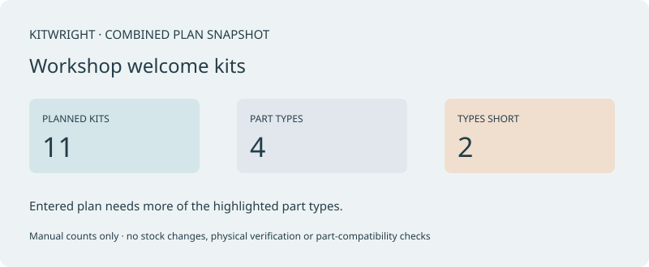

# Kitwright

**Know what the whole plan needs.**

Check several kit targets against one manual stock snapshot. Kitwright combines demand for shared components before it calculates shortages, so the same bag, card or part is not counted as available to every kit.



This is an actual exported SVG summary, **not an application screenshot**.

## Features

- Count up to 40 discrete part types, with unique codes and bin locations.
- Exclude manually entered outside-plan reserves from available stock.
- Plan up to eight kits with 100 kit/component recipe lines.
- Review combined need, shortage and unreserved remaining counts.
- Trace every component's demand back to its recipe lines.
- Compare independently calculated kit capacities without treating them as a combined allocation.
- Undo/redo the last 25 analyzed changes.
- Download editable project JSON, complete JSON/HTML receipts, guarded component CSV or summary SVG.

All calculations run locally. There are no accounts, analytics, remote fonts, uploads, supplier lookups or data-processing requests. The static host receives ordinary page/asset requests.

**Nothing is saved automatically. Download a project JSON before closing the tab.**

## Example

Choose **Load example** or open [examples/project.json](examples/project.json).

The fictional plan contains six Starter kits and five Mini kits. They share these supplies:

| Part code | On hand | Outside-plan reserve | Available | Combined need | Shortage | Unreserved remaining |
| --- | ---: | ---: | ---: | ---: | ---: | ---: |
| CARD | 20 | 2 | 18 | 17 | 0 | 1 |
| BAG | 10 | 1 | 9 | 11 | 2 | 0 |
| STICKER | 15 | 0 | 15 | 16 | 1 | 0 |
| RIBBON | 7 | 0 | 7 | 0 | 0 | 7 |

Starter kits alone have a capacity of nine; Mini kits alone have a capacity of seven. **Those capacities cannot be added together**: each assumes exclusive use of the same available stock. The combined plan is short of both bags and stickers.

Actual example outputs: [component CSV](examples/components.csv), [complete JSON receipt](examples/receipt.json), [standalone HTML report](examples/report.html).

## Run locally

Use Node.js 22 or 24.

```sh
npm ci --ignore-scripts --no-audit --no-fund
npm test
npm run example
npm run build
npm run dev
```

Open **http://127.0.0.1:4204**.

The build copies ten allowlisted static assets into `dist/`. Production has no runtime dependencies. jsdom is a development-only dependency for simulated-DOM tests.

## Use

1. Add parts with a unique code, name, manually counted on-hand quantity and optional location.
2. Enter any outside-plan reserve to exclude from available counts. This is a planning input, not a live reservation.
3. Add kits and planned quantities.
4. Add one recipe line for each kit/part pair, stating the whole units needed for one kit.
5. Choose **Check combined plan**.
6. Review the combined ledger, independent capacities and recipe-line contributions, then save or export.

New rows and edits remain a draft until a successful check. Exports pause while there are unapplied edits. Invalid inputs preserve the last analyzed snapshot. Preview filters and pages preserve draft inputs and never restrict exports.

A part referenced by a recipe cannot be deleted until its recipe lines are removed. **Remove kit & recipe** removes that kit and its lines from the draft; stock rows remain. A positive kit target must have at least one recipe line. A zero-target kit may have no recipe, and its capacity is shown as **No recipe**, rather than zero or unlimited.

New plan, example loading, undo/redo and imported projects replace unapplied drafts with an analyzed snapshot. Only analyzed changes enter history. Newer file selections and intervening edits invalidate pending reads.

## Count rules

For each component:

```text
available = on hand − outside-plan reserve
combined need = sum(units per kit × planned kit quantity)
shortage = max(0, combined need − available)
unreserved remaining = max(0, available − combined need)
```

The receipt also accounts for the portion of available stock that the plan would use. These are hypothetical counts: the report does not post a build, consume stock or create reservations.

A kit's standalone capacity is the smallest `floor(available / units per kit)` across its recipe lines. All limiting parts are recorded. Other kits' demand is deliberately excluded from this independent comparison; the combined ledger is the authority for the entered plan.

A “covered” result means only that **the entered component counts** cover **the entered recipe requirements**. It does not verify that stock exists, that a recipe is complete or that parts are compatible or suitable.

## Data limits

- 40 part types, eight kits, 100 recipe lines.
- On hand: 0–999,999 whole units; outside-plan reserve: 0 through the corresponding on-hand count.
- Planned quantity per kit: 0–9,999; recipe units: 1–9,999.
- Counts must use ordinary whole-number notation without leading zeros, fractions, signs or exponent notation.
- Part codes: 32 UTF-16 code units, unique by exact text; names: 80; locations: 64.
- Title: 80 code units; notes: 1,000.
- Project files: at most 1.2 MB and 300,000 decoded code units, strict UTF-8 with optional leading BOM.
- Project schema and references are validated before replacement. Duplicate JSON property names follow ordinary JSON parser behavior.

Codes and IDs are exact and case sensitive. No whitespace trimming, Unicode normalization, fuzzy matching, automatic substitutions or unit conversions are applied. Stable internal IDs keep recipes linked when displayed names/codes change.

This is a bounded count planner, not an inventory transaction system. It does not handle nested assemblies, weights, lengths, costs, supplier ordering, multiple stock lots, attrition, scheduling, an optimal production mix, device compatibility or team synchronization. Recount stale snapshots before relying on them.

## Exports and privacy

| Export | Contents |
| --- | --- |
| Project JSON | Original stock, reserves, kit targets, recipes and notes; can be reopened. |
| Full JSON receipt | Complete project, all component accounting, independent capacity details and every recipe-line contribution. |
| Full HTML report | Complete component ledger, kit/capacity table, contributions and notes. |
| Guarded component CSV | All component rows, locations and counts. Formula-like code/name/location text is prefixed with an apostrophe. |
| Summary SVG | Title and counts; not a full stock or recipe export. |

Projects and full receipts include notes and every stock/recipe row, including unused parts. Preview filters and pagination do not redact data.

CSV adds an apostrophe to labels beginning with optional whitespace followed by `=`, `+`, `-` or `@`, and reports how many labels changed. This **changes text** and is not a universal spreadsheet-security guarantee. JSON retains exact labels. Spreadsheet applications can still infer types or alter formatting; review imports in the receiving application.

## Verification

23 automated checks cover 120 independently recounted plans, shared-component demand, exact conservation identities, independent capacity enumeration, large integer totals, maximum project sizes, zero targets and stock, invalid reserves/references/duplicate recipe pairs, edit guards, history, strict UTF-8/BOM imports, literal HTML/SVG escaping and actual export Blob contents.

UI checks exercise add/edit/remove flows, atomic failures, ignored preview filters, pagination, stale reads and preservation of existing notes. CI runs on Windows/Linux with Node 22/24.

UI tests use **jsdom, a simulated DOM**. Native-browser interaction, responsive appearance, assistive-technology use, native download destinations, physical printing and an actual application screenshot have not been verified. Responsive CSS, semantic tables/forms and visible focus states are implemented; visual/accessibility certification is not claimed.

## Deploy manually to Vercel

Import this repository into your Vercel team. Select **Other**, repository root, Node.js **24.x**, build command `npm run build`, output directory `dist` and an empty install command. No environment variables, database, paid integration or purchased domain is required. The included `vercel.json` applies security headers and blocks outgoing browser connections.

## License

[MIT](LICENSE). No third-party code is bundled into the production app. Development dependencies retain their own licenses.
